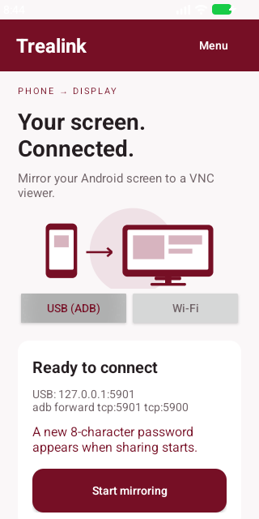

# Trealink

An independently implemented Android screen-mirroring app informed by REA analysis of the supplied **T-Link 1.3.12** APK. Includes a burgundy connection screen, USB/Wi-Fi modes, a connection guide, and Maps/Music/Web launcher shortcuts.



The reference APK is **JVC/Kenwood T-Link**, package `com.jvckenwood.tlink`, a VNC automotive mirroring application. You confirmed that reproducing mirroring is the intended scope. Folder listing, creation, renaming and deletion are **unsupported / not applicable** in this app. The original APK and existing user files are unchanged.

This is a working **view-only VNC prototype**, not a drop-in replacement for the proprietary JVC/Kenwood receiver integration. Receiver discovery/pairing, USB accessory transport, H.264 extensions, audio, and remote touch/keyboard control are not implemented. USB mode uses ADB forwarding. No original code, graphics or native libraries are bundled.

An independent car display carrying Android Auto while the phone remains usable is being investigated. See [the extension-mode feasibility and integration design](docs/extension-mode.md). This is a proposal, not a feature of the current APK; Android Auto hosting and the actual T-Link receiver transport both require validation.

## Run on Android

Requires Android 8.0+ (API 26), an Android phone or emulator, and a VNC viewer supporting **RFB 3.8 with VNC password authentication**.

The built APK is `D:\Work\Trealink\build\Trealink-debug.apk`. Install it, open **Trealink**, choose a connection mode, tap **Start mirroring**, and approve Android's sharing prompt. Choose **Share entire screen** to mirror between apps, or share one app if preferred.

### USB / emulator

Enable USB debugging and connect the phone, or start an emulator. From PowerShell:

```powershell
cd D:\Work\Trealink
.\scripts\run.ps1
# If multiple devices are attached:
# .\scripts\run.ps1 -Serial emulator-5554
& D:\Work\Android-Sdk\platform-tools\adb.exe forward tcp:5901 tcp:5900
```

After approving screen sharing, connect your VNC viewer to **127.0.0.1, TCP port 5901**, and enter the 8-character session password displayed in the app. Viewers that distinguish display numbers from ports may require `127.0.0.1::5901`.

### Wi-Fi

Put the phone and viewer on the same trusted network. Select **Wi-Fi**, start sharing, then connect the viewer to the phone address shown in Trealink, **TCP port 5900**. Use the displayed session password. The listener opens only while sharing and requires authentication. Standard VNC is unencrypted; this prototype is for a trusted local network, not public Internet exposure.

Tap **Stop mirroring**, use Android's screen-sharing status control, or use **Stop** in the notification if notifications are allowed. Stopping closes the viewer connection and listening socket. Every new session requires Android consent and generates a new password. The app saves only the selected connection mode; screen frames stay in memory.

## Build

No Gradle, npm packages, AndroidX, or network downloads are needed for the application build. The PowerShell build uses the installed JDK and Android SDK directly:

```powershell
.\scripts\build.ps1
# Override tool locations if needed:
.\scripts\build.ps1 -Sdk 'D:\Work\Android-Sdk' -Jdk 'D:\Work\rea-tools\jdk-21'
```

Prerequisites: JDK 17+, Android SDK platform **35**, and build tools **36.0.0**. The build compiles Java, creates DEX, packages, aligns and signs the APK, then verifies its signature. A local debug signing key is retained in `build/debug.keystore` for subsequent updates. The reference APK is never repackaged or modified.

## Verification

```powershell
.\scripts\test.ps1           # Real socket-level RFB protocol tests
.\scripts\test-android.ps1   # Automates consent only on a disposable emulator
```

The Android test uses an existing **disposable** emulator (`emulator-5554` by default), installs Trealink without clearing data, exercises the system consent dialogs, receives actual captured pixels, switches apps, and stops sharing. It also tests the network listener through emulator NAT; that is not a physical Wi-Fi or car-receiver test. Local test evidence is in `.local/android-test/`.

See [the test results](docs/verification.md) and [REA findings](analysis/findings.md) for exact coverage and limitations.

## Current limits

- One viewer at a time; raw true-color framebuffer updates capped at 5 per second.
- Capture is bounded to 720 × 1280 pixels, preserving the initial aspect ratio. Rotation uses a fixed canvas and may letterbox.
- Secure/DRM screens may be blank, as enforced by Android. No audio or remote input.
- Viewer compatibility is restricted to RFB 3.8 / VNC auth, raw pixels and 8/16/32-bit true-color formats. Compressed encodings are not implemented.
- Physical device, physical LAN and JVC/Kenwood receiver compatibility are unverified.
- The APK is a development build. The input APK is ignored by Git; retain your local copy to rerun REA analysis.

## Sources

- [REA](https://github.com/morluto/rea): APK/class/method evidence, retained locally.
- [Android MediaProjection documentation](https://developer.android.com/media/grow/media-projection): consent, foreground service, and capture lifecycle.
- [RFB protocol, RFC 6143](https://www.rfc-editor.org/rfc/rfc6143): framebuffer and VNC authentication wire formats.
