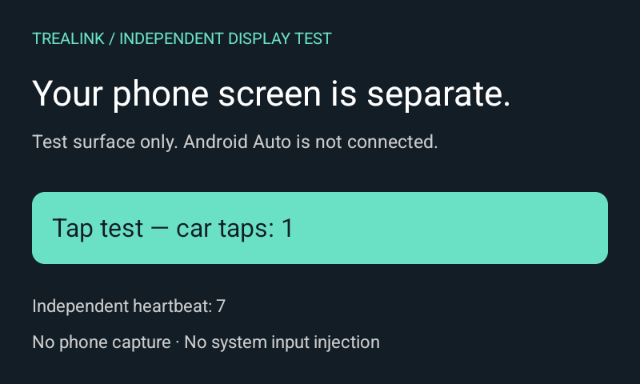
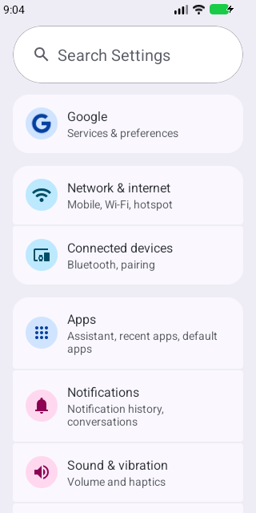

# Trealink

An independently implemented Android screen-mirroring app informed by REA analysis of the supplied **T-Link 1.3.12** APK. Includes a burgundy connection screen, USB/Wi-Fi modes, a connection guide, and Maps/Music/Web launcher shortcuts.


The reference APK is **JVC/Kenwood T-Link**, package `com.jvckenwood.tlink`, a VNC automotive mirroring application. You confirmed that reproducing mirroring is the intended scope. Folder listing, creation, renaming and deletion are **unsupported / not applicable** in this app. The original APK and existing user files are unchanged.

This is a VNC mirroring prototype with **optional direct touch control**. It is not a drop-in replacement for proprietary JVC/Kenwood receiver integration. Receiver discovery/pairing, USB accessory transport, H.264 extensions, audio, and remote keyboard input are not implemented. USB mode uses ADB forwarding. No original code, graphics or native libraries are bundled.

The current priority for **Galaxy A07 / One UI 9 and Kenwood DMXGT400R** is direct touch on a mirrored phone. The earlier independent-display diagnostic is retained as an experiment. Genuine Android Auto hosting and the actual T-Link receiver transport remain unimplemented. See [the hardware findings and integration design](docs/extension-mode.md).

## Direct touch control (0.3.0)

1. Open **Menu → Touch control → Enable direct touch**.
2. In Android Accessibility settings, enable **Trealink Touch Control**. On Samsung, the service may appear under **Installed apps**. Android may require the per-app **Allow restricted settings** action for a sideloaded APK; follow the system's available setup flow.
3. Choose **Phone screen mirroring** and start a new sharing session. Touch control requires **the entire screen**, so enabling it requests full-display capture. Existing app-only sharing must be restarted.
4. Connect the authenticated VNC viewer. Choose the viewer's **direct/absolute touch** mode rather than relative trackpad mode.
5. Tap a displayed point to tap the same phone position. Press and move to drag or scroll; hold to long-press. Only one finger is supported. **Menu → Touch test** opens disposable in-memory buttons, a slider and a scroll list for checking behavior.

Touch is off by default. The Accessibility service performs gestures only while local touch opt-in, an unlocked/interactive phone, full-screen capture and the matching viewer session are active. It does not request accessibility window contents or read keyboard input. Hover moves do not inject gestures. Disconnect, local off, stop and Android capture revocation end remote touch; an unattended held finger times out after 10 seconds. A physical touch can cause Android to cancel a remote gesture.

Coordinates are mapped to the phone display, including letterboxing after rotation. Touches in black bars are ignored. Supported RFB viewers receive an empty negotiated cursor shape; Trealink does not inject mouse events or draw a mouse-pointer overlay. A viewer or head unit can still draw its own cursor, which cannot be guaranteed hidden until receiver behavior is tested.

**This tests the phone-control engine through VNC. It does not yet let the Kenwood control the phone through its native T-Link USB connection.** The receiver transport and actual A07 input behavior still need hardware verification.

## Independent-display diagnostic (0.2.0)

Open **Menu → Output mode → Independent display test (no Android Auto)**, choose USB (ADB) or Wi-Fi, and tap **Start extend test**. Connect a VNC viewer using the same address/password procedure as mirroring. The viewer shows an independent 800 × 480 test panel while you can open other apps on the phone. Clicking the panel's tap-test region increments only its own counter. This mode does not request phone screen-capture permission.

Tap **Stop extend test** to release the virtual display. Return to **Menu → Output mode → Phone screen mirroring** to use the original mirror mode. The selected output mode is remembered. The A07's lack of DeX is not an obstacle assumed by this design: it uses Android's software display API, with actual A07 behavior still untested. This diagnostic does **not** provide Android Auto or connect to the Kenwood's T-Link USB port.

Emulator evidence: the viewer receives the independent test panel while the phone displays Settings. The viewer tap changes the panel's counter and leaves the phone app focused.

 

## Run on Android

Requires Android 8.0+ (API 26), an Android phone or emulator, and a VNC viewer supporting **RFB 3.8 with VNC password authentication**.

The built APK is `D:\Work\Trealink\build\Trealink-debug.apk`. Install it, open **Trealink**, choose a connection mode, tap **Start mirroring**, and approve Android's sharing prompt. Choose **Share entire screen** for direct touch. App-only sharing is available when touch control is off.

### USB / emulator

Enable USB debugging and connect the phone, or start an emulator. From PowerShell:

```powershell
cd D:\Work\Trealink
.\scripts\run.ps1
# If multiple devices are attached:
# .\scripts\run.ps1 -Serial emulator-5554
& D:\Work\Android-Sdk\platform-tools\adb.exe forward tcp:5901 tcp:5900
```

After approving screen sharing, connect your VNC viewer to **127.0.0.1, TCP port 5901**, and enter the 8-character session password displayed in the app. Viewers that distinguish display numbers from ports may require `127.0.0.1::5901`.

### Wi-Fi

Put the phone and viewer on the same trusted network. Select **Wi-Fi**, start sharing, then connect the viewer to the phone address shown in Trealink, **TCP port 5900**. Use the displayed session password. The listener opens only while sharing and requires authentication. Standard VNC is unencrypted; this prototype is for a trusted local network, not public Internet exposure.

Tap **Stop mirroring**, use Android's screen-sharing status control, or use **Stop** in the notification if notifications are allowed. Stopping closes the viewer connection and listening socket. Every phone-mirroring session requires Android capture consent; the independent diagnostic needs no capture grant. Both generate a new session password. The app saves only connection/output modes and local touch opt-in; frames stay in memory.

## Build

No Gradle, npm packages, AndroidX, or network downloads are needed for the application build. The PowerShell build uses the installed JDK and Android SDK directly:

```powershell
.\scripts\build.ps1
# Override tool locations if needed:
.\scripts\build.ps1 -Sdk 'D:\Work\Android-Sdk' -Jdk 'D:\Work\rea-tools\jdk-21'
```

Prerequisites: JDK 17+, Android SDK platform **35**, and build tools **36.0.0**. The build compiles Java, creates DEX, packages, aligns and signs the APK, then verifies its signature. A local debug signing key is retained in `build/debug.keystore` for subsequent updates. The reference APK is never repackaged or modified.

## Verification

```powershell
.\scripts\test.ps1           # Real socket-level RFB protocol tests
.\scripts\test-android.ps1   # Automates consent only on a disposable emulator
# Focus only on independent rendering and input isolation:
.\scripts\test-android.ps1 -ExtensionOnly
.\scripts\test-touch.ps1    # Real Accessibility gesture checks; disposable emulator only
```

The Android test uses an existing **disposable** emulator (`emulator-5554` by default), installs Trealink without clearing data, exercises the system consent dialogs, receives actual captured pixels, switches apps, and stops sharing. It also tests the network listener through emulator NAT; that is not a physical Wi-Fi or car-receiver test. Local test evidence is in `.local/android-test/`.

See [the test results](docs/verification.md) and [REA findings](analysis/findings.md) for exact coverage and limitations.

## Current limits

- One viewer at a time; raw true-color framebuffer updates capped at 5 per second. Mirror mode accepts single-finger touch only after explicit setup. Multi-touch/pinch and remote typing are not supported.
- Capture is bounded to 720 × 1280 pixels, preserving the initial aspect ratio. Rotation uses a fixed canvas and may letterbox.
- Secure/DRM screens may be blank, as enforced by Android. No audio. Touch is unavailable without Accessibility permission and whole-display capture, while locked, or after sharing stops.
- Viewer compatibility is restricted to RFB 3.8 / VNC auth, raw pixels and 8/16/32-bit true-color formats. Compressed encodings are not implemented.
- Physical device, physical LAN and JVC/Kenwood receiver compatibility are unverified.
- The APK is a development build. The input APK is ignored by Git; retain your local copy to rerun REA analysis.

## Sources

- [REA](https://github.com/morluto/rea): APK/class/method evidence, retained locally.
- [Android MediaProjection documentation](https://developer.android.com/media/grow/media-projection): consent, foreground service, and capture lifecycle.
- [RFB protocol, RFC 6143](https://www.rfc-editor.org/rfc/rfc6143): framebuffer and VNC authentication wire formats.
- [Android Accessibility gesture API](https://developer.android.com/reference/android/accessibilityservice/AccessibilityService#dispatchGesture(android.accessibilityservice.GestureDescription,android.accessibilityservice.AccessibilityService.GestureResultCallback,android.os.Handler)): user-enabled touch dispatch.
- [Android restricted-settings setup](https://support.google.com/android/answer/12623953): per-app setup for sideloaded apps when required.
