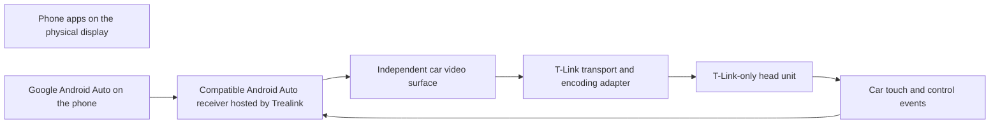

# Independent car display: feasibility and integration design

Status: **proposal; not implemented or verified on the user's car**. Reviewed 2026-11-15.

The user wants the phone to remain independently usable while a T-Link-only head unit shows and controls Android Auto. The phone runs Samsung One UI 9. Samsung identifies One UI 9 as Android 17; the exact Galaxy model, head-unit model and firmware are still needed. The existing Android 17 emulator tests are not Samsung-device or car-compatibility tests.

## Feasibility

Separating the phone screen from a car-rendering surface is supported by Android. `DisplayManager` can create an own-content virtual display, and `Presentation` or an app-owned activity can render to that display. A decoder can also render a received video stream into a separate surface without capturing the phone's display. This supports an independent car interface in principle.

The full request has two additional dependencies: obtaining genuine Android Auto output and speaking the head unit's T-Link protocol. Neither is solved by creating a virtual display. This design is a technical direction, not a promise that an ordinary install will make this particular car support Android Auto.

## Proposed data path

The desired property is that `SURFACE` receives the Android Auto host's video, not a capture of `PHONE`. Input returns to the Android Auto host's input channel rather than being injected into the phone's current foreground app. The car can continue using its existing T-Link connection **if** the adapter implements the expected receiver handshake, video encoding, framing and control messages.

## Android Auto integration

The public Android for Cars App Library lets an app provide supported car experiences to a host. It does not expose a public call that embeds the whole Google Android Auto launcher, Maps, media and system UI into an arbitrary Trealink view. The Android Auto application itself is a host for Car App Library apps; writing one such app does not implement an Android Auto receiver.

For genuine Android Auto output, the bridge would need a compatible projection receiver/session implementation. Google's Desktop Head Unit demonstrates receiving and controlling Android Auto on a development computer. Its developer workflow can connect to a phone's head-unit server over TCP port 5277 through ADB forwarding. This documents a development test route; it does not establish that a same-phone receiver in Trealink will be accepted, that it can start silently, or that it is a supported production integration. Same-device operation, protocol compatibility and session setup must be tested explicitly.

An independently drawn car dashboard is another possible source for the independent surface. That would be Trealink's own UI, not genuine Google Android Auto, and does not meet the user's full request by itself.

## Changes relative to the current implementation

| Piece | Current prototype | Required extension |
| --- | --- | --- |
| Video source | `MediaProjection`, physical-screen capture using `AUTO_MIRROR` | Independent render/decoder surface; own-content virtual display when needed |
| Car interface | No Android Auto host | Compatible Android Auto receiver, session and lifecycle integration |
| Transport | Standard password-authenticated RFB 3.8 over TCP; USB uses ADB forwarding | Actual receiver-compatible T-Link USB/session adapter |
| Input | RFB key/pointer messages are discarded | Parse receiver controls and route them to the car surface / Android Auto session only |
| Audio | None | Validate receiver audio path, calls, microphone, focus and routing separately |
| Connect behavior | Manual start and Android capture consent | Validate USB attachment/permission, explicit setup, disconnect cleanup and permitted background behavior |

Simply replacing `AUTO_MIRROR` with `OWN_CONTENT_ONLY` inside `MediaProjection` is not a complete implementation. The source of car content, host integration, surface ownership, service lifecycle and input routing must be designed together. An app-owned surface does not require reading the physical phone display, but that fact does not grant access to other applications' private UI or permission to launch arbitrary apps on any display.

## Validation order

1. Identify the exact Galaxy model, head-unit model/firmware and reference T-Link connection behavior. Preserve current working connections and data.
2. Prove an independent app-owned surface on the actual Samsung phone: switch phone apps while a test receiver keeps receiving only the car surface. Exercise remote input and verify it cannot target the phone display. This proves separation, not Android Auto compatibility.
3. Validate a real Android Auto session with the official Desktop Head Unit, then determine whether a same-device compatible receiver is practical on this phone. Retain video/input evidence instead of treating an open TCP port as success.
4. Reverse engineer and verify the head unit's T-Link negotiation, encoding and input transport against the reference APK and hardware. Generic VNC success is insufficient.
5. Integrate the Android Auto surface with that transport; test disconnects, lock/revocation behavior, phone multitasking, resolution changes, input focus and audio on the actual vehicle while parked.

Until both the Android Auto receiver path and the T-Link transport are established, describe this feature as experimental research. Do not label the current APK as Android Auto-capable or automatically compatible with T-Link-only receivers. Root, ADB or developer-mode requirements cannot be decided from the One UI version alone.

## Primary references

- [Samsung One UI update information](https://www.samsung.com/in/support/mobile-devices/one-ui-software-update/): One UI 9 / Android 17.
- [DisplayManager](https://developer.android.com/reference/android/hardware/display/DisplayManager): `OWN_CONTENT_ONLY`, `AUTO_MIRROR`, surface ownership and display flags.
- [Presentation](https://developer.android.com/reference/android/app/Presentation): presenting app-owned content on another display.
- [Android activity launch policy](https://source.android.com/docs/core/display/multi_display/activity-launch): private-display ownership and cross-app launch restrictions.
- [Car App Library fundamentals](https://developer.android.com/codelabs/car-app-library-fundamentals): client/host relationship.
- [Android for Cars App Library](https://developer.android.com/training/cars/apps/library): public app integration scope.
- [Desktop Head Unit](https://developer.android.com/training/cars/testing/dhu): official Android Auto receiver testing and developer head-unit server workflow.
