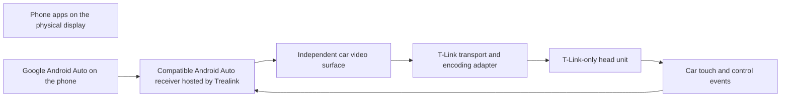

# Independent car display: feasibility and integration design

Status: **independent-display diagnostic implemented; Android Auto and car transport remain proposals**. Reviewed 2026-11-15. No verification on the user's phone or car has been performed.

The user wants the phone to remain independently usable while a T-Link-only head unit shows and controls Android Auto. The reported hardware is **Samsung Galaxy A07, One UI 9**, and **Kenwood DMXGT400R**. Samsung identifies One UI 9 as Android 17. Exact handset SKU and head-unit firmware have not been inspected. Android 17 emulator tests are not Samsung-device or car-compatibility tests.

## Hardware-specific findings

Samsung's Indonesian Galaxy A07 specification (SM-A075F family) lists USB Type-C / USB 2.0 and **no Samsung DeX support**. Consequently this implementation does not rely on DeX. The absence of DeX does not establish that an app-owned software virtual display is unavailable; that is a separate Android API and must be checked on the actual handset.

The user reports that the DMXGT400R supports T-Link and does not support native Android Auto. JVCKENWOOD's AVX documentation describes a T-Link workflow combining Bluetooth pairing/profiles, a USB cable and the phone application. It also notes that later Android versions may not work. That describes the product family, not a verified USB protocol contract or a compatibility guarantee for the user's receiver firmware. An Android Auto dongle that requires an existing native Android Auto port is not a solution established by this evidence.

The diagnostic uses **800 × 480 as a test canvas**, not as a claim about the receiver's measured resolution. It connects to a standard VNC viewer over ADB forwarding or a local network; it does not connect to the Kenwood receiver yet.

## Implemented diagnostic

Choose **Menu → Output mode → Independent display test (no Android Auto)**, then start the test. This creates a private `DisplayManager` virtual display with `OWN_CONTENT_ONLY | PRESENTATION`, renders a clearly labeled test panel into it, and streams its pixels through the existing authenticated RFB transport. It does not obtain a `MediaProjection` token or read the phone screen.

The independent display has its own heartbeat and tap counter. Authenticated, in-bounds RFB pointer events are sent only to that app-owned test view. No accessibility service, global input injection, root or arbitrary cross-app activity launching is used. The existing phone-mirroring mode remains view only. Stop releases the presentation, display, image reader and network listener. An explicitly selected connected-device foreground-service type keeps the app-owned network display session alive while another phone app is open.

This diagnostic establishes a place to connect a future Android Auto decoder/renderer. Its test panel is not an Android Auto substitute and is not represented as a car-ready UI.

## Feasibility

Separating the phone screen from a car-rendering surface is supported by Android. `DisplayManager` can create an own-content virtual display, and `Presentation` or an app-owned activity can render to that display. A decoder can also render a received video stream into a separate surface without capturing the phone's display. This supports an independent car interface in principle.

The full request has two additional dependencies: obtaining genuine Android Auto output and speaking the head unit's T-Link protocol. Neither is solved by creating a virtual display. This design is a technical direction, not a promise that an ordinary install will make this particular car support Android Auto.

## Proposed data path

The desired property is that `SURFACE` receives the Android Auto host's video, not a capture of `PHONE`. Input returns to the Android Auto host's input channel rather than being injected into the phone's current foreground app. The car can continue using its existing T-Link connection **if** the adapter implements the expected receiver handshake, video encoding, framing and control messages.

## Android Auto integration

The public Android for Cars App Library lets an app provide supported car experiences to a host. It does not expose a public call that embeds the whole Google Android Auto launcher, Maps, media and system UI into an arbitrary Trealink view. The Android Auto application itself is a host for Car App Library apps; writing one such app does not implement an Android Auto receiver.

For genuine Android Auto output, the bridge would need a compatible projection receiver/session implementation. Google's Desktop Head Unit demonstrates receiving and controlling Android Auto on a development computer. Its developer workflow can connect to a phone's head-unit server over TCP port 5277 through ADB forwarding. This documents a development test route; it does not establish that a same-phone receiver in Trealink will be accepted, that it can start silently, or that it is a supported production integration. Same-device operation, protocol compatibility and session setup must be tested explicitly.

An independently drawn car dashboard is another possible source for the independent surface. That would be Trealink's own UI, not genuine Google Android Auto, and does not meet the user's full request by itself.

## Changes relative to the current implementation

| Piece | Current prototype | Required extension |
| --- | --- | --- |
| Video source | Phone mirror via `MediaProjection`; diagnostic via an app-owned virtual display | Attach genuine Android Auto output to the independent surface |
| Car interface | No Android Auto host | Compatible Android Auto receiver, session and lifecycle integration |
| Transport | Standard password-authenticated RFB 3.8 over TCP; USB uses ADB forwarding | Actual receiver-compatible T-Link USB/session adapter |
| Input | Phone mirror discards input; diagnostic routes bounded pointers only to its own test view | Parse actual receiver controls and route them to the Android Auto session only |
| Audio | None | Validate receiver audio path, calls, microphone, focus and routing separately |
| Connect behavior | Manual start and Android capture consent | Validate USB attachment/permission, explicit setup, disconnect cleanup and permitted background behavior |

Simply replacing `AUTO_MIRROR` with `OWN_CONTENT_ONLY` inside `MediaProjection` is not a complete implementation. The source of car content, host integration, surface ownership, service lifecycle and input routing must be designed together. An app-owned surface does not require reading the physical phone display, but that fact does not grant access to other applications' private UI or permission to launch arbitrary apps on any display.

## Validation order

1. Target the reported Galaxy A07 / One UI 9 and Kenwood DMXGT400R; verify exact firmware and reference T-Link connection behavior. Preserve current working connections and data.
2. Prove an independent app-owned surface on the actual Samsung phone: switch phone apps while a test receiver keeps receiving only the car surface. Exercise remote input and verify it cannot target the phone display. This proves separation, not Android Auto compatibility.
3. Validate a real Android Auto session with the official Desktop Head Unit, then determine whether a same-device compatible receiver is practical on this phone. Retain video/input evidence instead of treating an open TCP port as success.
4. Reverse engineer and verify the head unit's T-Link negotiation, encoding and input transport against the reference APK and hardware. Generic VNC success is insufficient.
5. Integrate the Android Auto surface with that transport; test disconnects, lock/revocation behavior, phone multitasking, resolution changes, input focus and audio on the actual vehicle while parked.

Until both the Android Auto receiver path and the T-Link transport are established, describe this feature as experimental research. Do not label the current APK as Android Auto-capable or automatically compatible with T-Link-only receivers. Root, ADB or developer-mode requirements cannot be decided from the One UI version alone.

## Primary references

- [Samsung One UI update information](https://www.samsung.com/in/support/mobile-devices/one-ui-software-update/): One UI 9 / Android 17.
- [Samsung Indonesia Galaxy A07 specifications](https://www.samsung.com/id/business/smartphones/galaxy-a/galaxy-a07-light-violet-128gb-sm-a075flvgxid/): USB 2.0 and no DeX.
- [JVCKENWOOD AVX T-Link guidance](https://21cy.jvckenwood.com/): Bluetooth/USB workflow and Android-version compatibility limitations for the family.
- [DisplayManager](https://developer.android.com/reference/android/hardware/display/DisplayManager): `OWN_CONTENT_ONLY`, `AUTO_MIRROR`, surface ownership and display flags.
- [Presentation](https://developer.android.com/reference/android/app/Presentation): presenting app-owned content on another display.
- [Android activity launch policy](https://source.android.com/docs/core/display/multi_display/activity-launch): private-display ownership and cross-app launch restrictions.
- [Car App Library fundamentals](https://developer.android.com/codelabs/car-app-library-fundamentals): client/host relationship.
- [Android for Cars App Library](https://developer.android.com/training/cars/apps/library): public app integration scope.
- [Desktop Head Unit](https://developer.android.com/training/cars/testing/dhu): official Android Auto receiver testing and developer head-unit server workflow.
- [Foreground service types](https://developer.android.com/develop/background-work/services/fgs/service-types): connected-device and media-projection session requirements.
